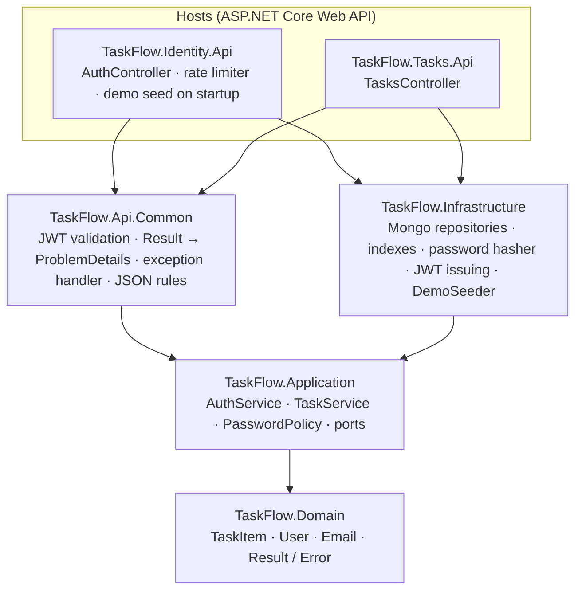
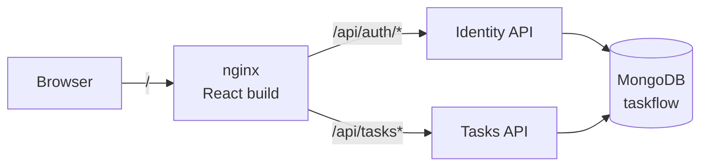

# Architecture

## Layers

Clean Architecture: dependencies point inwards. The Domain depends on nothing, Application owns the ports (interfaces), and Infrastructure implements them.

At runtime, the browser only ever talks to nginx:

| Project | Holds | Doesn't hold |
|---|---|---|
| Domain | Task rules: trimming, limits, due date in the past or removed, status changes, overdue and *Completed late*. The email format. | I/O, the clock, frameworks. `now` is passed in as a parameter. |
| Application | Use cases, ownership checks, password policy, lockout, refresh-token rotation, query validation. The ports. | ASP.NET, Mongo. |
| Infrastructure | Mongo mapping and queries, indexes, PBKDF2 hashing, signing JWTs, the demo seed. | Business rules. |
| Api.Common | Everything both APIs share at the HTTP edge. | Use-case logic. |

## Decisions and trade-offs

**Two APIs, one database.**
- **Why:** identity and tasks deploy and scale separately, and the Tasks API never sees a password.
- **Cost:** two processes and a shared signing key. A single database keeps setup to one command. Both APIs read and write the same database; splitting it later means a database per API.

**Shared `Api.Common` project.**
- **Why:** both APIs need the same JWT validation, error mapping and JSON rules. Application can't reference ASP.NET, and Infrastructure isn't the place for HTTP concerns.
- **Cost:** a fourth `src` project.

**Expected failures are `Result`s, not exceptions.**
- **How:** validation, not-found, conflict, invalid credentials and lockout come back as a `Result` with typed `Error`s (code, message, optional field). `ResultHttp` is the one place that turns them into ProblemDetails, with per-field errors in the standard `errors` shape.
- **Unexpected failures:** anything else is an exception, logged and answered with a bare 500.
- **Cost:** some `if (result.IsFailure) return ...` boilerplate in the services.

**Rules live where the data is.**
- **Domain:** entity methods (`Create`, `Edit`, `ChangeStatus`) validate and return every error at once.
- **Application:** the password policy lives here because the domain only ever sees a hash.
- **Cost:** the overdue rule exists twice, in `TaskItem.IsOverdue` and in the Mongo filter, because filtering has to happen in the database. Tests cover both.

**Time goes through `TimeProvider`.**
- **How:** the services read the clock and pass `now` into the domain, so tests use `FakeTimeProvider` and run on exact instants (one tick before, at, after).
- **Precision:** times are trimmed to milliseconds to match BSON, so a task reads back exactly as it was returned.

**Due dates are UTC instants.**
- **Storage:** stored as BSON dates.
- **API:** the API rejects a date without an offset. Read in the server's own time zone, it would silently change depending on where the server runs.
- **UI:** the UI shows and edits local time. An untouched due date is sent back exactly, because the input only has minute precision.

**Privacy is enforced twice: in the database and in the service.**
- **Database:** the repository only finds and saves the owner's tasks that aren't deleted: `GetById` takes the owner id, and `Update` matches on it. Listing filters by owner too. A new use case can't reach someone else's task even if it forgets a check.
- **Service:** every single-task operation also checks the owner and the soft delete in one place (`FindOwnedAsync`), and its tests prove that check on its own.
- **Result:** someone else's, deleted and missing tasks all answer the same 404. The owner id always comes from the token, never from the request.

**Sessions.**
- **Access token:** a 15-minute HS256 JWT, kept in frontend memory only.
- **Refresh token:** a random 256-bit value in an `HttpOnly`, `Secure`, `SameSite=Strict` cookie scoped to `/api/auth`. Only its SHA-256 hash is stored, with a TTL index for cleanup. Each use rotates it through a conditional update, so two racing requests can't both rotate the same token.
- **Reuse detection:** reusing a rotated token revokes every session of that user, on the assumption that it was stolen. That makes the frontend share one in-flight refresh between all callers. Otherwise StrictMode or two parallel 401s would log the user out. Across tabs, which share the cookie, refreshes take turns under a Web Lock, so a second tab sends the rotated cookie, not the used one.
- **Cost:** an access token stays valid for up to 15 minutes after logout.

**Lockout in Mongo, rate limit in memory.**
- **Lockout:** three failures lock an email for one minute, whether it's registered or not, so the lock reveals nothing about which emails exist. It's stored in Mongo, so it survives restarts and works across instances. It's a read-then-write, so parallel attempts can get a few extra tries, which the per-IP limit caps.
- **Rate limit:** the per-IP limit (10 per minute on login and register) is the built-in fixed-window limiter, per instance. nginx overwrites `X-Forwarded-For` so clients can't spoof it.
- **Accepted cost:** someone can keep a known email locked out, and a bot spread across many IPs can still try emails slowly.

**Timing-safe login.**
- **How:** an unknown or malformed email still checks a password against a dummy hash, so response times don't reveal which emails are registered.
- **Error:** wrong email and wrong password give the identical 401.

**MongoDB with the official driver and no ORM.**
- **How:** class maps keep the entities free of attributes. A unique index on the normalized email is what actually prevents duplicate accounts, even under concurrent registration.
- **Sorting:** sort by due date uses an `$addFields` flag so tasks without one go last in both directions. Every sort ends on `createdAt` and `_id`, so pages never repeat or skip tasks.

**Last write wins.**
- **How:** `PUT` replaces the editable fields, and status has its own `PATCH`, so an edit made in another tab doesn't undo a status change.
- **Deletes win:** a save only matches a task that's still not deleted, so an edit that loses the race against a delete changes nothing and answers 404 instead of bringing the task back.
- **Cost:** there's no optimistic concurrency token, and the update replaces the whole document. A `PUT` and a `PATCH` landing in the same few milliseconds can still overwrite each other's fields.

**Demo seed on Identity API startup.**
- **How:** it's idempotent. If the demo email exists, it does nothing; if two instances race, the unique index lets only one win. The tasks are created through the normal domain rules, backdated, so the overdue and *Completed late* examples need no special path.
- **Cost:** a crash between creating the user and its tasks leaves a demo without tasks until the volume is reset.

**Single origin.**
- **How:** nginx in compose and the Vite proxy in dev serve the app and both APIs from one origin. There's no CORS, and the refresh cookie stays first-party with `SameSite=Strict`.

**Testing.**
- **Domain and Application:** unit tests with fakes and NSubstitute.
- **Infrastructure and both APIs:** Testcontainers against a real Mongo. Mongo-specific behavior (unique index, TTL, sorting, paging) is only trusted when it runs against Mongo itself.
- **Frontend:** Vitest + Testing Library with a fake `fetch`.
